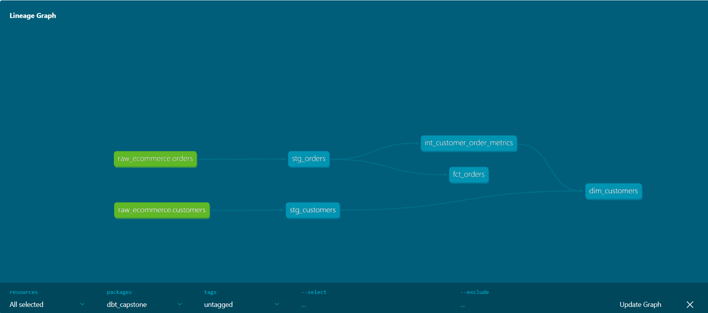

# dbt E-commerce Capstone

A small end-to-end analytics engineering project. It takes messy raw **customer** and **order** data and turns it into clean, tested tables that are ready for BI tools, using **dbt Core** and **Snowflake**.

## What this project does

- Loads two raw CSV files into Snowflake
- Cleans and standardizes the data (staging layer)
- Calculates customer metrics such as first order, latest order, order count and lifetime value (transform layer)
- Publishes a customer profile table and an order transactions table (marts layer)
- Checks data quality automatically with dbt tests

## Tech stack

| Tool | Used for |
|---|---|
| Snowflake | Data warehouse |
| dbt Core | Transformations, tests and documentation |
| VS Code + Python | Development environment |
| Git and GitHub | Version control |

## Dataset

| File | Rows | Description |
|---|---|---|
| `raw_customers.csv` | 11 | `id`, `first_name`, `last_name`, `email`, `signup_date` |
| `raw_orders.csv` | 18 | `order_id`, `user_id`, `order_timestamp`, `status`, `amount` |

### Data problems found and how they are handled

| Problem in the raw data | Fix |
|---|---|
| Emails in mixed case | Lowercased and trimmed |
| One customer has a blank email | Blank becomes `NULL` |
| One signup date has a trailing space | Trimmed before converting to a date |
| Timestamps are text like `10th January 2026 09:15:22` | Ordinal suffix removed, then parsed into a real date |
| Order 1018 appears twice (one copy has no customer) | De-duplicated, keeping the row that has a customer |
| `status` is a numeric code (1, 2, 3) | Mapped to readable names with a seed file |

## Project structure

```
dbt_capstone/
├── dbt_project.yml
├── setup/
│   ├── raw_customers.csv
│   ├── raw_orders.csv
├── seeds/
│   ├── order_status_codes.csv
│   └── seeds.yml
└── models/
    ├── staging/
    │   ├── sources.yml
    │   ├── staging.yml
    │   ├── stg_customers.sql
    │   └── stg_orders.sql
    ├── transform/
    │   └── int_customer_order_metrics.sql
    └── marts/
        ├── marts.yml
        ├── dim_customers.sql
        └── fct_orders.sql
```

## How the data flows



## Layers

| Layer | Models | Stored as | What it does |
|---|---|---|---|
| Staging | `stg_customers`, `stg_orders` | view | Cleans raw data: renames keys, fixes types, casing and dates, removes duplicates |
| Transform | `int_customer_order_metrics` | view | Groups orders by customer and calculates the metrics |
| Marts | `dim_customers`, `fct_orders` | table | Final tables for BI: one row per customer and one row per order |

### Final tables

**`dim_customers`** (one row per customer): customer details plus first order date, most recent order date, total orders and customer lifetime value. Customers with no orders are kept, with zero orders and zero lifetime value.

**`fct_orders`** (one row per order): order id, customer id, order date, status code, status name and amount.

## Business rules

- **Total orders** counts every order placed.
- **Customer lifetime value (CLV)** is the total amount of orders with the status `success`. Orders marked `fail` or `return` are not counted.
- **Status names** in `seeds/order_status_codes.csv` (1 = success, 2 = fail, 3 = return) are placeholder names, because the source data does not define the codes. Update the CSV if the real meanings differ.

## Data quality tests

| Test | Applied to |
|---|---|
| `unique` | `customer_id` and `order_id` in staging and marts, `status_code` in the seed |
| `not_null` | All ids, `order_date` and `order_amount` |
| `relationships` | Every `customer_id` in `fct_orders` exists in `dim_customers` |
| `accepted_values` | `order_status` is one of 1, 2 or 3 |

In total: 4 models, 1 seed and 17 tests.

## How to run it

### Prerequisites

- Python 3.10 to 3.12
- A Snowflake account
- Git

### Steps

1. **Clone the repo and set up Python**

   ```bash
   git clone https://github.com/dikshita-patidar/dbt_capstone.git
   cd dbt_capstone
   python -m venv .venv
   pip install dbt-snowflake
   ```

2. **Create the raw data in Snowflake**

   Create `ECOMMERCE_DB.RAW` with the `customers` and `orders` tables and load the data. Check that it holds 11 customers and 18 orders.

3. **Configure the connection**

   Update the profiles.yml file with Snowflake account details.

4. **Test the connection**

   ```bash
   dbt debug
   ```

5. **Build everything (seed, models and tests)**

   ```bash
   dbt build
   ```

6. **View the documentation and lineage graph**

   ```bash
   dbt docs generate
   dbt docs serve
   ```

   Then open `http://localhost:8080` and click the graph icon at the bottom right. Press `Ctrl+C` to stop the server.

## Expected results

- `fct_orders` has **17** rows (18 raw orders minus the duplicate)
- `dim_customers` has **11** rows (one per customer)
- All models build and all tests pass

## What I learned

- Structuring a dbt project into staging, transform and marts layers
- Cleaning messy real-world data with SQL and Jinja
- Using sources, `ref()`, seeds, materializations and tests
- Generating documentation and lineage with dbt docs
- Working with Git and GitHub for version control